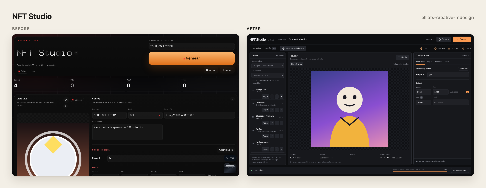
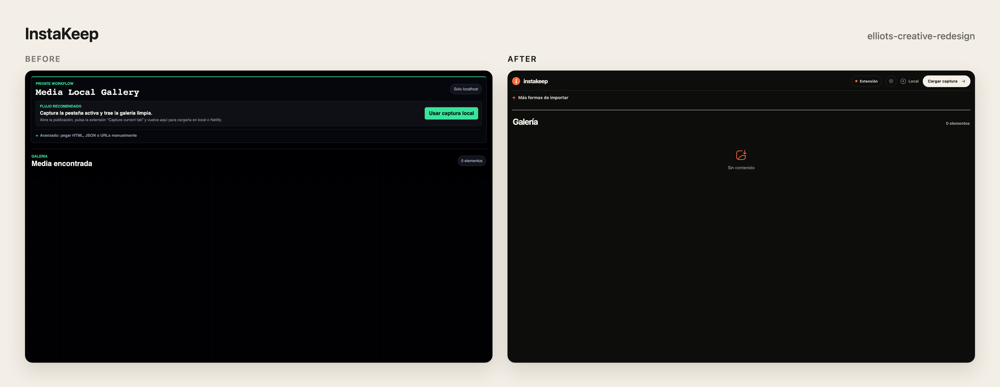
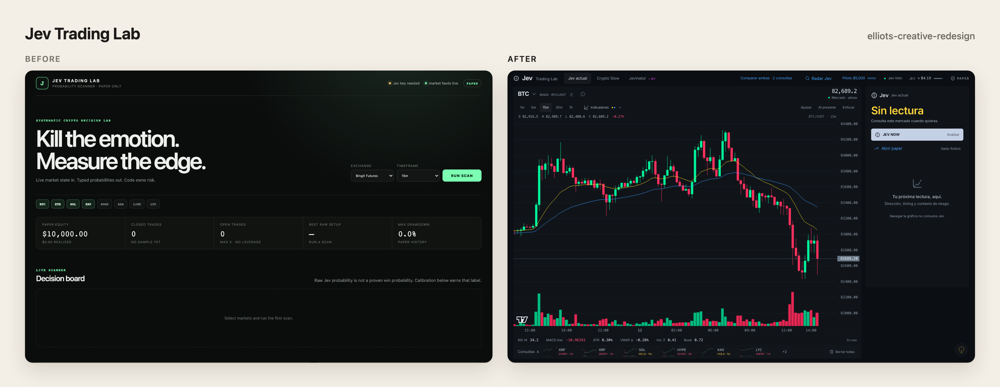

# Elliot’s Creative Skill

**Dirección creativa y rediseño de productos para Astra en Codex.**

Este paquete está pensado para usarse con **Astra**. Selecciona ese modelo en Codex; la skill aporta criterio de diseño y no cambia el modelo por su cuenta.

## Novedades de la v2

La v2 junta todo en una sola skill, [`elliots-creative-skill`](elliots-creative-skill/SKILL.md), para crear algo nuevo o rediseñar algo que ya existe. Cambia la forma de trabajar:

1. **Primero pregunta.** Antes de diseñar, el agente revisa lo que ya existe y hace sólo las preguntas que faltan: ¿es una herramienta que usas a diario?, ¿una landing que vende?, ¿una campaña?, ¿un portafolio? Con las respuestas escribe un brief de cinco líneas.
2. **Clasifica la superficie.** Una herramienta prioriza velocidad y claridad; una landing, una conversión; una campaña o un portafolio, personalidad y memoria.
3. **Usa componentes reales de [BoardUI](https://www.boardui.com/).** El código de todos sus componentes gratis es público (MIT): el agente lo lee completo desde su registro o su [repo en GitHub](https://github.com/BoardUI/boardui), sin CLI ni MCP, y los ve funcionando en el navegador. En React 19 + Tailwind v4 los mete al proyecto tal cual; en otros stacks los traduce. Los Pro son de paga: sin licencia no toma su código por ninguna vía.
4. **Propone al menos tres direcciones distintas.** No son tres paletas sobre el mismo layout: cambian estructura, tipografía, material, movimiento y momento memorable. Recomienda una y espera tu elección.
5. **Crea con libertad.** BoardUI es el piso, no el techo: el agente cambia sus tokens, edita el código de los componentes, inventa piezas nuevas y mezcla recursos expresivos aprendidos del portafolio de [Kenji Lambert](https://www.kenjilambert.com/), sin copiarlo.
6. **Verifica lo real.** Corre la interfaz y revisa la acción principal, los estados, el teclado, el contraste y el movimiento reducido.

¿Tenías instalada `elliots-creative-redesign`? Bórrala e instala sólo `elliots-creative-skill`. Lo que hacía ahora vive en [`references/redesign.md`](elliots-creative-skill/references/redesign.md).

## Antes y después

La skill le quita lo *slop* a tu proyecto: si tu app se hizo rápido con IA y se ve como todas (tarjetas genéricas, degradados por todos lados, una plantilla de dashboard con tu logo), le da una decisión de diseño real sin romper sus funciones.

Capturas reales de proyectos rediseñados con la versión anterior de esta skill, tomadas levantando el código de cada versión. Donde el original tenía datos privados se usaron datos de muestra.







## Cómo pedírselo

Basta con decir qué quieres; la skill pregunta lo que falte. Si ya tienes el contexto, dáselo de una vez y se salta esas preguntas:

- **Qué es:** herramienta, dashboard, interfaz de IA, landing, campaña, portafolio.
- **Para quién y qué acción importa:** quién lo usa, cada cuánto y qué debe lograr.
- **Estado actual:** repo, URL o capturas, si ya existe.
- **Qué se conserva:** funciones, datos, marca, URLs.
- **Restricciones:** stack, dispositivos, presupuesto para componentes Pro.

### Ejemplo: rediseñar una herramienta

```text
Usa $elliots-creative-skill.

Esta app ayuda a un equipo de soporte a revisar y asignar tickets todo el día.
Su tarea principal es comparar prioridad, responsable y estado.
El repo es [ruta] y la app corre en [URL].

Quiero mejor distribución y claridad en escritorio. Conserva filtros, permisos
y reglas de asignación.
```

### Ejemplo: una landing nueva

```text
Usa $elliots-creative-skill.

Necesito una landing para vender un curso de cerámica. El stack es Next.js con Tailwind v4.
```

En el segundo caso la skill te preguntará lo que falta (precio, público, pruebas reales, tono) antes de proponer tres direcciones.

## Instalar

Pídele a Codex:

```text
Instala la skill de este repositorio:
https://github.com/troghx/elliots-creative-skill/tree/main/elliots-creative-skill
```

También puedes copiar la carpeta `elliots-creative-skill/` dentro de `~/.codex/skills/` (Codex) o `~/.claude/skills/` (Claude Code).

No necesitas instalar nada de BoardUI: la skill lee el código de los componentes directo de su registro público. Su servidor MCP (`claude mcp add boardui -- npx -y boardui@latest mcp`; ver [su guía](https://www.boardui.com/mcp)) y su CLI son atajos opcionales.

## Filosofía

- Preguntar antes de componer.
- Tres direcciones reales antes de construir.
- Componentes reales antes que imitaciones.
- En software de uso frecuente, los controles, datos y acciones tienen prioridad.
- Personalidad propia: las referencias se traducen, no se copian.
- Hugeicons como referencia principal; Lucide como alternativa válida.
- Verificar la interfaz real, su accesibilidad y sus interacciones.

## Licencia

MIT. BoardUI y las referencias citadas pertenecen a sus autores; esta skill sólo enlaza y resume observaciones públicas.
